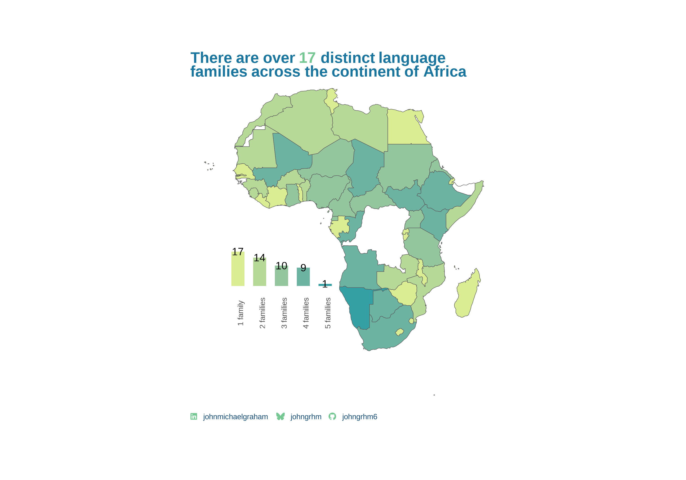

### Load Packages

```{r}

library(tidytuesdayR)
library(tidyverse)
library(treemapify)
library(rnaturalearth)
library(rnaturalearthdata)
library(sf)
library(ggtext)
library(patchwork)
library(glue)
library(showtext)


font_add(family = "Font Awesome 7",regular ="~/Documents/Code/R Studio/Fonts/fontawesome-free-7.3.1-desktop/otfs/Font Awesome 7 Brands-Regular-400.otf")
font_add_google(family = "Arimo",name = "Arimo")

body_font <- "Arimo"
showtext_auto()
showtext_opts(dpi=300)

text_col <- "#184e77"
highlight_col <- "#76c893"
bg_col <- "white"


family_colours <- c("Kxʼa"="#d9ed92",        
 'Niger–Congo'="#b5e48c",
 'Afroasiatic'="#99d98c" ,
 'Indo-European'="#76c893",
 'Nilo-Saharan'="#52b69a",
 'Mande'="#34a0a4",
 'Portuguese'="#168aad",
 'Khoe–Kwadi'="#1a759f", 
 'Afro-Asiatic'="#1e6091",
'Arabic-based'="#184e77",
'Kongo-based'="#80ffdb",
'English' ="#72efdd",
'Austronesian'="#64dfdf",
'French'="#4ea8de",    
'Ubangian'="#5e60ce",   
'Tuu'="#6930c3" )

### Caption Function
 social_caption <- function(
            linkedin="johnmichaelgraham",
            github="johngrhm6",
            bluesky="johngrhm",
            icon_color = "black",
            font_color = "black",
            font_family = "sans") {
  
  icons_df <- data.frame(
        icons = c("&#xf08c;", "&#xe671;", "&#xf09b;"),
        socials = c(linkedin, bluesky, github)
  )
  icons_df <- na.omit(icons_df)
  
  glue_icon <- function(icon,social){
    glue::glue(
      "<span style='font-family:\"Font Awesome 7\"; 
      color:{icon_color};'>{icon} </span>&nbsp; <span style='font-family:{font_family}; 
      color:{font_color};'>{social} </span>&emsp;"
    )
  }

  # Map over all icons
  caption <- purrr::map2(
    .x = icons_df$icons,
    .y = icons_df$socials,
    .f = ~glue_icon(.x, .y)
  ) |> 
    purrr::as_vector() |> 
    stringr::str_flatten()

  return(caption)
}

social <- social_caption(
  icon_color = highlight_col,
  font_color = text_col,
  font_family = body_font
)
```

### Data Wrangling

```{r}
tt_data <- tt_load(2026, week=2)

africa <- tt_data$africa

africa_sf <- rnaturalearth::ne_countries(scale = "medium",continent = "Africa")

africa_families <- africa |> 
  group_by(country) |> 
  mutate(TotalLanguageFamily = n_distinct(family),
         Families = paste(unique(family),collapse = "\n")) |> 
  ungroup() |> 
  select(country,TotalLanguageFamily,Families) |> 
  distinct()


africa_families_mapped <- africa_families|> 
  mutate(country = case_match(.x = country,.default = country,
    "Ivory Coast"~"Côte d'Ivoire",
    "Central African Republic"~"Central African Rep.",
    "South Sudan"~"S. Sudan",
    "Equatorial Guinea"~"Eq. Guinea",
    "Cape Verde"~"Cabo Verde",
    "Eswatini"~"eSwatini",
  )) |> 
  right_join(africa_sf |> select(name),by=c("country"="name")) 

```

### Plot

```{r fig.height= 7,fig.width=10}
subtitle <- glue("There are over <span style='color:{highlight_col}'>**{n_distinct(africa$family)}**</span> distinct language families across the continent of Africa")

map <- africa_families_mapped |> 
  ggplot()+
  geom_sf(aes(geometry=geometry,fill=`TotalLanguageFamily`))+
  scale_fill_gradient(low = "#d9ed92",high = "#34a0a4",na.value = "white")+
  labs(fill = "Language Families",
       subtitle = subtitle,
       caption = social)+
  theme_minimal(base_size = 10)+
  theme(plot.background = element_rect(fill = "white",colour = "white"),
        plot.margin=margin(2,2,2,2,unit = "cm"),
        plot.caption = element_textbox_simple(),
        panel.grid = element_blank(),
        plot.subtitle = element_textbox_simple(colour = family_colours[8],hjust = 0.5,
                                        lineheight = 0.5,face = "bold",
                                        size = 16),
        legend.position = "none",
        axis.title = element_blank(),
        axis.text = element_blank(),
        panel.background = element_rect(fill = "white",colour = "white"))


bar <- africa_families |> 
  group_by(TotalLanguageFamily) |> 
  summarise(n=n()) |> 
  ggplot(aes(x=factor(TotalLanguageFamily),y=n,fill=TotalLanguageFamily))+
  geom_col(width = 0.6)+
  geom_text(aes(label=n))+
  scale_fill_gradient(low = "#d9ed92",high = "#34a0a4",na.value = "white")+
  theme_minimal(base_size = 10)+
  scale_x_discrete(labels = c("1 family","2 families","3 families","4 families","5 families"))+
  scale_y_continuous(expand = c(0.2,0))+
  theme(axis.title = element_blank(),
        axis.text.y = element_blank(),
        axis.text.x = element_text(angle = 90),
        legend.position = "none",panel.grid = element_blank()
        )


p <- map+inset_element(bar,left = 0.2,right = 0.5,top = 0.5,bottom = 0.3,align_to = "full")

p

 
```
### Save Plot

```{r}
getwd()
ggsave(plot=p,filename ="2026-week2.png",width = 10,height = 7 )
```

