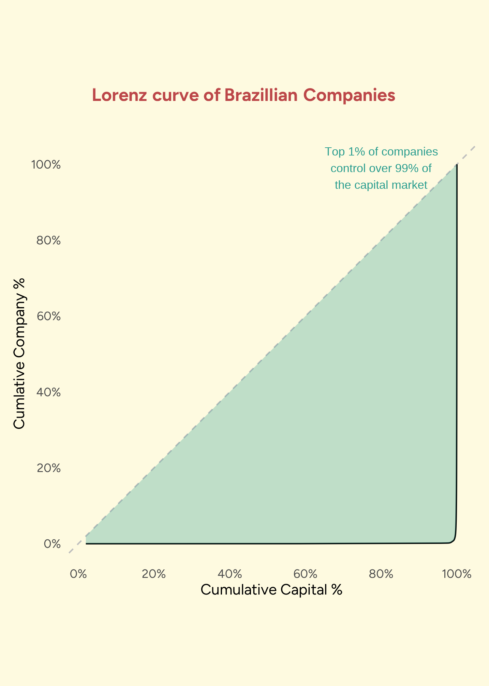

{width=300px height=450px}
### Load Packages
```{r}
library(tidyverse)
library(tidytuesdayR)
library(ggbeeswarm)
library(ggridges)
library(camcorder)
library(ggtext)
library(showtext)

getwd()
gg_record(
  dir = file.path("./TidyTuesdayProjects/plots/2026/week4/","recording"),
  device = 'png',
  width = 5,
  height = 7,
  units = 'in',
  dpi = 300
)
font_add_google(name = "Figtree",family = "Figtree",regular.wt = 400)
f1 <- "Figtree"
showtext_auto()
showtext_opts(dpi=300)
tt_data <- tt_load(2026, week=4)

```

### Data Exploration
```{r}
for (data in tt_data){
  glimpse(data)
}

companies_raw <- tt_data$companies

companies_raw |> 
  skimr::skim()

```

### Data Wrangling & Plot
```{r}

capital_concentration <- companies_raw |> 
  arrange(desc(capital_stock)) |> 
  mutate(comp_pct = row_number()/n(),
         capital_stock_pct =cumsum(capital_stock)/sum(capital_stock))


annotations <- capital_concentration |> 
  summarise(top_1 = capital_stock_pct[ceiling(n()*.01)],
            top10 = capital_stock_pct[ceiling(n()*0.1)],
            companies_90 = min(which(capital_stock_pct>=0.9))
            )
  

companies_raw |> 
  arrange(desc(capital_stock)) |> 
  mutate(company_pct = row_number()/n(),
         capital_stock_pct = cumsum(capital_stock)/sum(capital_stock)) |> 
  ungroup() |> 
  ggplot()+
  geom_abline(intercept = 0,slope = 1,linetype = 'dashed',colour = 'grey')+
  geom_line(aes(y=company_pct,
                x=capital_stock_pct))+
  geom_ribbon(aes(y=company_pct,
                x=capital_stock_pct,
                ymin = company_pct,
                ymax = capital_stock_pct),fill='#2a9d8f',alpha = 0.3)+
  labs(title = "**Lorenz curve of Brazillian Companies**",
       x="Cumulative Capital %",
       y="Cumlative Company %")+
  scale_x_continuous(labels = scales::percent,breaks = seq(0,1,0.2))+
  scale_y_continuous(labels = scales::percent,breaks = seq(0,1,0.2))+
  annotate(geom = 'text',x=0.8,y=0.99,
           size=3,
           colour ="#2a9d8f",
           label=str_wrap("Top 1% of companies control over 99% of the capital market",width = 20))+
  coord_equal()+
  theme_minimal(base_family = f1)+
  theme(plot.title = element_textbox_simple(halign = 0.5,colour ="#bc4749",margin = margin(t=0,b=30)),
        plot.title.position = "plot",
        panel.grid = element_blank(),
        plot.margin = margin(margin(5,10,5,10)),
        panel.background = element_rect(fill="#fefae0",colour = "#fefae0"),
        plot.background = element_rect(fill="#fefae0",colour = "#fefae0")
        )


```


